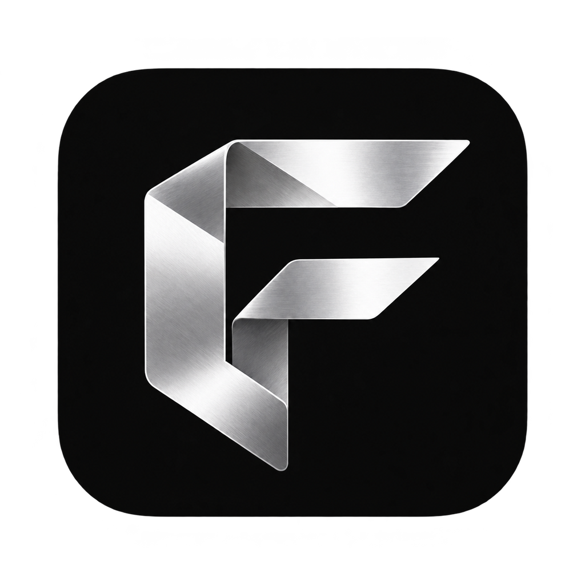

<p align="center"></p>
<h1 align="center">Frame</h1>
<p align="center">本地媒体工具箱 · macOS / Windows</p>

Frame 为设计师和动效制作人员提供动画格式转换、音频压缩和视频帧导出。支持拖放、多文件队列、预览、进度、取消、质量调节与重新导出。素材在电脑上处理，无需上传。

## 下载

从 [Releases](https://github.com/ReeCHECK/Frame/releases) 获取安装包。

| 平台 | 安装方式 |
| --- | --- |
| Windows 10 / 11 x64 | 运行 Setup.exe，或完整解压 Portable.zip 后运行 Frame.exe |
| macOS 13+，Apple Silicon / Intel | 解压 macOS.zip，打开其中的 Frame.app |

应用未进行商业代码签名，macOS 包未公证。Windows 版尚未完成真机运行验证；已完成共享代码的真实 Electron 集成验证及 Windows 安装包静态检查。见 [验证范围](docs/verification.md)。

## 功能

| 功能 | 输出与设置 |
| --- | --- |
| SVGA → PAG | 保留原尺寸、帧率和透明背景；小体积—均衡质量调节 |
| SVGA → PNG 序列 | 按原始帧或指定帧率导出透明 PNG；支持尺寸调整 |
| PAG → PNG 序列 | 逐帧渲染真实画面，保留透明背景，自动编号 |
| SVGA → GIF | 帧率、尺寸、背景、调色板质量 |
| PAG → GIF | 帧率、尺寸、背景、调色板质量 |
| 图片压缩 | JPG / PNG / WebP；画质、尺寸、格式与原图对比 |
| MP3 压缩 | 在体积和听感之间调整；最高档复制原音频流 |
| MP4 → PNG 序列 | 无损 PNG；可选择提取帧率和尺寸 |

选择工具 → 添加文件 → 预览并调整设置 → 开始转换。完成后可以继续调整设置并重新导出，原结果保留，同名自动编号。

PAG 的两个端点统一使用视频压缩，不提供体积巨大的逐帧无损“高”档。滑块表示编码取舍，不是画面保真百分比。macOS 与 Windows 的编码参数不同，结果不保证逐字节一致。PAG 输出图层合并，不能恢复为原 SVGA 的可编辑图层。

GIF 最多 256 色，不支持连续半透明或音频。SVGA → PAG 支持 SVGA 2.x 无音轨素材；输入尺寸和处理总量受限以控制资源占用。

图片压缩支持静态 JPG、PNG 和 WebP。PNG 原格式直接无损优化，JPEG / WebP 可调画质，也可设置长边上限或转为 WebP；支持原图与结果对比。同格式、同尺寸输出未变小时自动保留原图。压缩档位不代表像素保真百分比，动态 PNG / WebP 暂不支持。

所有工具的空状态配图、说明与选文件按钮均对应当前功能。PNG 序列默认保留原尺寸与原帧率；SVGA / PAG 提取帧率不高于源帧率，输出为 `frame_000000.png` 起的连续编号文件夹。调整设置后可重新导出，旧文件夹保留。

## 源码结构

```text
macos/                 Swift / AppKit 原生宿主、WebKit 界面及编码器桥接
windows/               Electron 宿主、Node 转换流程、PAG 视频写入模块
  app/ui/              工作台与本地渲染页面
  app/vendor/          SVGAPlayer / libpag（保留各自许可）
docs/                  验证说明与项目资源
THIRD_PARTY_NOTICES.md  第三方组件及来源
```

两端目前为独立宿主，提供相同产品流程；尚未合并为统一跨平台构建。

## 构建 Windows

需要 Node.js 22.12+。只需使用软件的用户不需要安装开发依赖。

```sh
cd windows
npm ci
npm run build:windows
```

输出位于 `windows/dist/Frame 3.4 Windows`。构建脚本下载并校验 Electron 与 FFmpeg。FFmpeg 上游 `latest` 资产可能变化，哈希不一致会停止；可使用原始依赖缓存，或通过发布版便携目录重建：

```sh
node build-windows.cjs --runtime "C:\path\to\Frame 3.4 Windows"
```

生成安装器需要 NSIS 3，确保 `makensis` 在 PATH，或设置 `NSIS_EXE`：

```sh
node build-windows.cjs --runtime "C:\path\to\Frame 3.4 Windows" --installer
```

更多细节见 [Windows 构建说明](windows/README-build.md)。

## 构建 macOS

需要 macOS、Apple Command Line Tools 和 Python 3。先从 Releases 下载并解压 macOS 包，使用其中的 Frame.app 作为第三方运行资源基底；此命令重建 Swift 主程序和 C 桥接程序：

```sh
cd macos
FRAME_BASE_APP="/absolute/path/to/Frame.app" ./build.command
```

输出位于 `macos/build/Frame.app`。这不是完全从零构建第三方二进制的流程；PAGConvertor / H264EncoderOriginal 由腾讯提供，FFmpeg / LAME 的来源、校验值与构建脚本见 [第三方说明](THIRD_PARTY_NOTICES.md) 和 [macOS 开发说明](macos/DEVELOPMENT.md)。

## 贡献

欢迎通过 Issues 反馈问题或通过 Pull Request 提交修改。请注明平台、Frame 版本、复现步骤与错误信息；只提供可公开或脱敏的最小测试素材，不要提交私人素材、密钥或个人路径。

## 许可

Frame 自有源码采用 [MIT](LICENSE)。播放器、编码器和开发工具保持各自许可，详见 [第三方说明](THIRD_PARTY_NOTICES.md)。MIT 不替代 FFmpeg、x264、libpag 等组件的许可。
